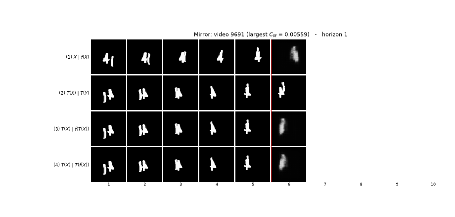
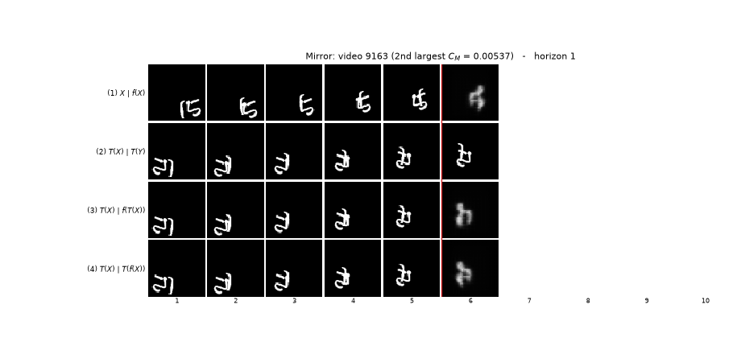
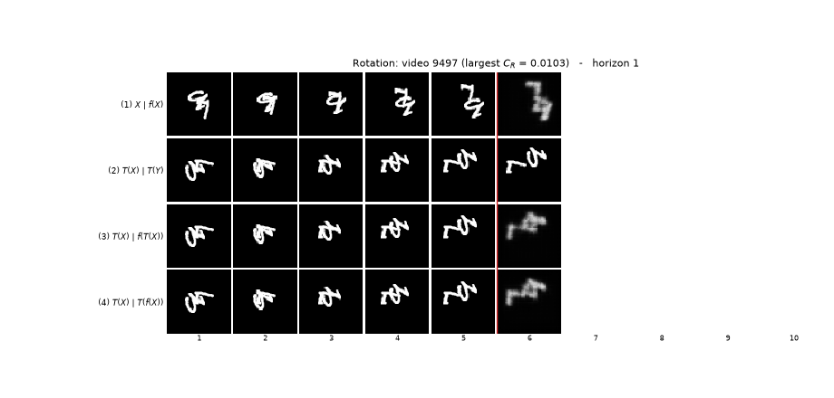
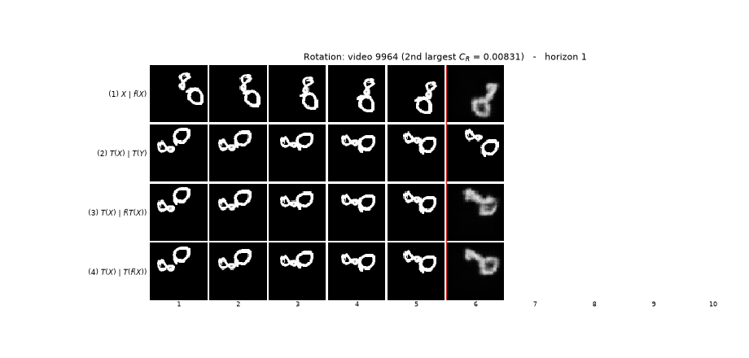

# AI651 Assignment 2 (Fall 2026)

Muhammad Hussain Habib (27100016)

Deep Learning for Space, Time and Graphs. Question 1 is the river-intervention
submission backed by code, figures and results. Question 2 is the Moving MNIST
ConvLSTM study: the baseline model, optical-flow analysis, test-set evaluation
and transformation checks.

| path | what it is |
|---|---|
| `DL4STG_PA2.pdf` | the assignment sheet: start here |
| `report.pdf` | the report: start here |
| `report.tex` | the LaTeX source of the report |
| `figures/` | every figure the report includes |
| `q1/` | the Question 1 submission: `q1/code/`, `q1/figures/`, `q1/results/` |
| `Question1/` | the executed full-preset code for Question 1 (`assignment2/` package, `Question1.ipynb`, checkpoints beside it) |
| `q2/` | the Question 2 submission: `q2/code/`, `q2/figures/`, `q2/results/` |
| `q2/code/` | ConvLSTM model, baseline training/evaluation and optical flow, plus the transformation and speed-up experiments |
| `q2/figures/` | report figure copies plus the animated Figure 3 GIFs |
| `q2/results/` | result JSONs for Tables 2, 3 and 4 (seeds 0 and 1) |
| `tutorial/` | the tutorial HTML for Question 1 and Question 2 |

## Question 1 in one paragraph

The submission reproduces the river-intervention experiments: the trained models,
the diagnostic/probe scripts, the lookback-contrast and upstream analyses, the
ensemble uncertainty calibration, and the figures and result tables reported in
the write-up. See `q1/code/run_all_lab.sh` for the exact commands and
`q1/results/` for the per-experiment JSON summaries.

`Question1/checkpoints/` (the `.pt` weights) are not committed; they are large
and regenerable with the scripts above.

## Question 2 in one paragraph

The baseline is the two-layer ConvLSTM of Shi et al. (2015) without peepholes:
`pixel_unshuffle(4)`, two 64-channel 3x3 ConvLSTM layers, and a 1x1 convolution
plus `pixel_shuffle(4)` and sigmoid. It is trained for 30 epochs with Adam
(lr = 1e-3, batch 32) on videos 0-7,999, validated on 8,000-8,999 and evaluated
on 9,000-9,999. `q2/code/check_transformations.py` reproduces Table 1; Figure 1
comes from `q2/code/compute_optical_flow.py`; Figure 2 and Table 2 come from
`q2/code/evaluate_model_a.py`. `q2/code/evaluate_transformations.py` and
`q2/code/make_transformation_figures.py` produce Table 3, Figure 3 (with the
four GIFs in `q2/figures/`) and Figure 4; `q2/code/evaluate_speed.py` and
`q2/code/make_speed_figure.py` produce Table 4 and Figure 5.
`q2/results/` holds the JSONs for Tables 2, 3 and 4 for seeds 0 and 1. Model
checkpoints live in `runs/` on the GPU machine and are not committed because
they are regenerable.

## Figure 3 GIFs

The four Figure 3 panels are saved as animated GIFs in `q2/figures/`. Each one
steps through the five forecast horizons while keeping the same four rows.

Mirror, largest `C_M` (`q2/figures/fig3_mirror_rank1_video9691.gif`):

Mirror, second largest `C_M` (`q2/figures/fig3_mirror_rank2_video9163.gif`):

Rotation, largest `C_R` (`q2/figures/fig3_rotation_rank1_video9497.gif`):

Rotation, second largest `C_R` (`q2/figures/fig3_rotation_rank2_video9964.gif`):

